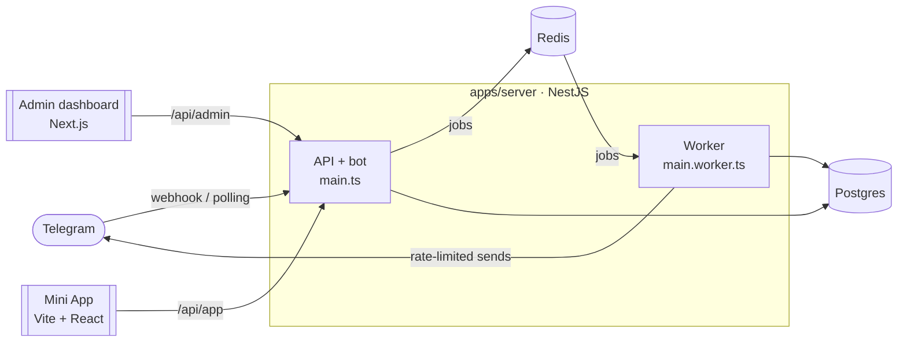

# tgstack

**The production-ready, full-stack Telegram starter.** A NestJS + grammY bot, a Telegram Mini App, an admin dashboard, rate-limited broadcasts and Telegram Stars payments: one TypeScript monorepo, tested, documented and deployable with one command.

[](./LICENSE)


English · [Tiếng Việt](./README.vi.md)

<!-- Demo GIF (bot → Mini App purchase → admin dashboard): docs/assets/demo.gif -->

## Why tgstack?

Most Telegram projects start from a bot template and then grow the same pieces by hand: a database, an admin panel, a Mini App, broadcasts that do not get the bot rate-limited, payments. tgstack ships those pieces already wired together, with the boring parts (auth, rate limits, idempotency, i18n, tests, deployment) done.

| | A bot template (grammY, Telegraf, nestjs-telegraf…) | A Mini App template | **tgstack** |
|---|---|---|---|
| Bot with commands, sessions, conversations | ✓ | — | ✓ NestJS DI + grammY plugins |
| Mini App with verified `initData` auth | — | ✓ frontend | ✓ frontend + server validation |
| Admin dashboard (users, stats, broadcasts, payments) | — | — | ✓ Next.js + shadcn/ui |
| Broadcasts that respect Telegram's limits | — | — | ✓ BullMQ queue, `429`/`403` handling, live progress |
| Telegram Stars payments + refunds | — | some | ✓ signed payloads, idempotent, provider interface |
| Shared i18n (bot, dashboard, Mini App) | some | some | ✓ Fluent, English + Vietnamese |
| Tests without the real Bot API | — | — | ✓ `MockBotApi` |
| Docker + HTTPS deployment | some | — | ✓ Caddy, one domain |

Pick a template when you need only a bot or only a Mini App. Pick tgstack when you are building a product on Telegram.

## Features

- **Bot**: [`@tgstack/nestjs-grammy`](./packages/nestjs-grammy) gives grammY a NestJS face: `@Update()` classes, `@Command()`, `@On()`, guards, interceptors and filters on handlers. Long polling in development, webhooks with a secret token in production. Sessions and conversations in Redis, user tracking (including who blocked the bot), localized command menus.
- **Mini App**: Vite + React 19 + `@tma.js/sdk-react`, styled with Telegram's theme colors. Every request carries `initData`, verified on the server (HMAC, max age). Runs in a normal browser during development with signed mock data.
- **Admin dashboard**: Next.js 16, shadcn/ui, TanStack Query and Table. Passwordless sign-in: send `/admin` to the bot, click the one-time link. Stats with charts, user search, a broadcast composer with a Telegram-style preview, payments with refunds. Light/dark, English/Vietnamese.
- **Broadcasts**: target a segment (language, activity, buyers or not) with a live recipient count, send now or schedule for later. A separate worker process sends through BullMQ at a steady, configurable rate. A `429` pauses the whole queue for `retry_after`; users who blocked the bot are marked and skipped next time. Progress streams to the dashboard over SSE; broadcasts can be cancelled.
- **Payments**: Telegram Stars invoices from the bot or the Mini App, fast pre-checkout validation, idempotent recording, refunds from the dashboard. Vietnamese bank transfers (VietQR) through PayOS, with signed webhooks. Other gateways plug in through a `PaymentProvider` interface.
- **Engineering**: strict TypeScript, zod-validated environment and API (shared schemas generate the OpenAPI spec), Prisma 7, Pino logs, health checks, Biome, Turborepo, 200+ tests against real Postgres and Redis, GitHub Actions CI, Docker images published to GHCR.

## Quick start (5 minutes)

You need Node.js 24, pnpm 12, Docker and a bot token from [@BotFather](https://t.me/BotFather) (use a separate bot for development).

```bash
git clone https://github.com/<you>/tgstack.git && cd tgstack
pnpm install
cp .env.example .env
```

In `.env`, set `BOT_TOKEN`, `JWT_SECRET` (`openssl rand -hex 32`) and `ADMIN_TELEGRAM_IDS` (your Telegram ID, from [@userinfobot](https://t.me/userinfobot)). Then:

```bash
pnpm infra:up      # Postgres + Redis in Docker
pnpm db:migrate    # create the tables
pnpm db:seed       # sample products, makes you an admin
pnpm dev           # bot + API + worker, dashboard, Mini App
```

| | |
|---|---|
| Bot | send `/start` to your bot |
| Dashboard | send `/admin` to the bot and open the link (http://localhost:3001) |
| Mini App | http://localhost:5173 in a browser (mocked Telegram environment); inside Telegram it needs an HTTPS URL, see [Mini App](./docs/miniapp.md) |
| API docs | http://localhost:3000/api/docs |

**No bot token yet?** `pnpm --filter @tgstack/server dev:mock` runs the server against an in-memory Bot API and prints a dashboard login link; start the dashboard next to it with `pnpm --filter @tgstack/admin dev`.

More: [development guide](./docs/development.md).

## Architecture



| Path | What |
|---|---|
| `apps/server` | NestJS: bot + REST API (`main.ts`) and queue worker (`main.worker.ts`), organized as `common/`, `infra/`, `bot/`, `modules/`, `examples/` |
| `apps/admin` | Next.js admin dashboard |
| `apps/miniapp` | Vite + React Telegram Mini App |
| `packages/nestjs-grammy` | Publishable NestJS module for grammY |
| `packages/db` | Prisma schema, migrations, seed |
| `packages/shared` | zod schemas, `initData` validation, constants shared by every app |
| `packages/i18n` | Fluent translations (English, Vietnamese) |
| `packages/config` | Shared TypeScript and Biome configuration |

The layering rules (which package may import which, the bot middleware order, the API namespaces) are in [docs/architecture.md](./docs/architecture.md) and checked by a test.

## Removing example modules

The shop (products sold for Stars) and the onboarding wizard exist to show how the pieces fit. Every file is marked `// EXAMPLE:` and lives in its own folder; deleting them leaves auth, users, broadcasts and payments working. Step-by-step: [docs/examples.md](./docs/examples.md).

## Documentation

[Development](./docs/development.md) · [Architecture](./docs/architecture.md) · [Bot](./docs/bot.md) · [Admin API](./docs/admin-api.md) · [Dashboard](./docs/admin.md) · [Broadcasts](./docs/broadcasts.md) · [Mini App](./docs/miniapp.md) · [Payments](./docs/payments.md) · [Examples](./docs/examples.md) · [Deployment](./docs/deployment.md) · [Decisions](./docs/decisions.md)

## Deployment

One VPS, one domain, automatic HTTPS:

```bash
cp .env.example .env   # DOMAIN, BOT_TOKEN, secrets
docker compose -f docker-compose.prod.yml up -d --build
```

Caddy serves the dashboard at `/`, the Mini App at `/app/` and the API and bot webhook behind them. Prebuilt images are published to GHCR on every release. Details: [docs/deployment.md](./docs/deployment.md).

## FAQ

**Why NestJS for a bot?** A bot that grows into a product needs what NestJS already has: modules, dependency injection, guards, validation, testing utilities. `@tgstack/nestjs-grammy` keeps grammY's full API; you can use any grammY plugin.

**Why grammY rather than Telegraf?** grammY follows the Bot API closely, has typed plugins for sessions, conversations, i18n, runner and auto-retry, and is actively maintained.

**Can I use only the bot (no dashboard, no Mini App)?** Yes. Delete `apps/admin` and `apps/miniapp`; the server does not depend on them.

**Does it run on serverless platforms?** The API can, in webhook mode, but broadcasts need a long-running worker and Redis. tgstack targets a VPS or any container platform.

**Why are Telegram IDs strings in the API?** They can exceed JavaScript's safe integer range. They are `BigInt` in the database and strings in JSON.

**Can I accept money other than Stars?** Telegram requires Stars for digital goods sold inside Telegram. For other cases implement a `PaymentProvider` ([payments](./docs/payments.md)).

**How do I add a language?** Add `packages/i18n/locales/<code>/` with the same keys, and the code to `SUPPORTED_LOCALES` (`packages/shared/src/constants`); a test checks that no key is missing.

## Contributing

Issues and pull requests are welcome. Read [CONTRIBUTING.md](./CONTRIBUTING.md) first; good first issues are listed in [docs/backlog.md](./docs/backlog.md). Please follow the [Code of Conduct](./CODE_OF_CONDUCT.md).

## License

[MIT](./LICENSE)
