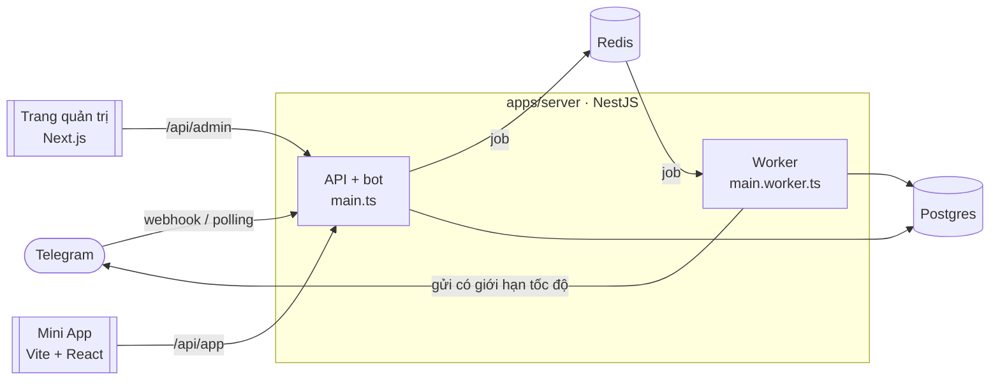

# tgstack

**Bộ khởi đầu Telegram full-stack, sẵn sàng cho production.** Bot NestJS + grammY, Telegram Mini App, trang quản trị, gửi tin hàng loạt có giới hạn tốc độ và thanh toán Telegram Stars: một monorepo TypeScript, có test, có tài liệu và triển khai bằng một lệnh.

[](./LICENSE)


[English](./README.md) · Tiếng Việt

<!-- GIF demo (bot → mua hàng trong Mini App → trang quản trị): docs/assets/demo.gif -->

## Vì sao chọn tgstack?

Phần lớn dự án Telegram bắt đầu từ một template bot, rồi tự làm dần những mảnh giống nhau: cơ sở dữ liệu, trang quản trị, Mini App, gửi tin hàng loạt mà không bị Telegram giới hạn, thanh toán. tgstack đã nối sẵn các mảnh đó, kèm luôn những phần khó làm đúng: xác thực, giới hạn tốc độ, chống ghi trùng, đa ngôn ngữ, test và triển khai.

| | Template bot (grammY, Telegraf, nestjs-telegraf…) | Template Mini App | **tgstack** |
|---|---|---|---|
| Bot có lệnh, session, hội thoại nhiều bước | ✓ | — | ✓ NestJS DI + plugin grammY |
| Mini App xác thực `initData` | — | ✓ phía frontend | ✓ frontend + kiểm tra ở server |
| Trang quản trị (người dùng, thống kê, gửi tin, thanh toán) | — | — | ✓ Next.js + shadcn/ui |
| Gửi tin hàng loạt đúng giới hạn của Telegram | — | — | ✓ hàng đợi BullMQ, xử lý `429`/`403`, tiến độ trực tiếp |
| Thanh toán Telegram Stars + hoàn tiền | — | một số | ✓ payload có chữ ký, không ghi trùng, interface cho cổng khác |
| i18n dùng chung (bot, trang quản trị, Mini App) | một số | một số | ✓ Fluent, tiếng Anh + tiếng Việt |
| Test không gọi Bot API thật | — | — | ✓ `MockBotApi` |
| Triển khai Docker + HTTPS | một số | — | ✓ Caddy, một tên miền |

Chỉ cần bot hoặc chỉ cần Mini App thì dùng template là đủ. Khi xây một sản phẩm trên Telegram, hãy dùng tgstack.

## Tính năng

- **Bot**: [`@tgstack/nestjs-grammy`](./packages/nestjs-grammy) đưa grammY vào NestJS: class `@Update()`, `@Command()`, `@On()`, guard, interceptor và filter ngay trên handler. Long polling khi phát triển, webhook có secret token khi chạy production. Session và hội thoại lưu trong Redis, theo dõi người dùng (kể cả ai đã chặn bot), menu lệnh theo từng ngôn ngữ.
- **Mini App**: Vite + React 19 + `@tma.js/sdk-react`, dùng màu theme của Telegram. Mọi request đều kèm `initData` và được server kiểm tra (HMAC, thời hạn). Khi phát triển có thể chạy trên trình duyệt thường với dữ liệu giả lập đã ký.
- **Trang quản trị**: Next.js 16, shadcn/ui, TanStack Query và Table. Đăng nhập không mật khẩu: gửi `/admin` cho bot rồi bấm link dùng một lần. Thống kê có biểu đồ, tìm người dùng, soạn tin hàng loạt với bản xem trước giống Telegram, danh sách thanh toán và hoàn tiền. Có giao diện sáng/tối, tiếng Anh/tiếng Việt.
- **Gửi tin hàng loạt**: chọn nhóm người nhận (ngôn ngữ, mức hoạt động, đã mua hay chưa) và xem ngay số người nhận, gửi ngay hoặc hẹn giờ. Một tiến trình worker riêng gửi qua BullMQ với tốc độ đều, cấu hình được. Gặp `429` thì cả hàng đợi tạm dừng theo `retry_after`; người đã chặn bot được đánh dấu và bỏ qua ở lần sau. Tiến độ cập nhật trực tiếp lên trang quản trị qua SSE, và có thể huỷ giữa chừng.
- **Thanh toán**: hoá đơn Telegram Stars từ bot hoặc Mini App, kiểm tra pre-checkout nhanh, ghi nhận không trùng lặp, hoàn tiền từ trang quản trị. Muốn thêm cổng thanh toán khác thì cài interface `PaymentProvider`.
- **Kỹ thuật**: TypeScript strict, biến môi trường và API được kiểm tra bằng zod (schema dùng chung sinh ra luôn OpenAPI), Prisma 7, log Pino, health check, Biome, Turborepo, hơn 200 test chạy trên Postgres và Redis thật, CI bằng GitHub Actions, image Docker đăng lên GHCR.

## Bắt đầu nhanh (5 phút)

Cần Node.js 24, pnpm 12, Docker và một bot token từ [@BotFather](https://t.me/BotFather) (nên dùng bot riêng cho môi trường phát triển).

```bash
git clone https://github.com/<you>/tgstack.git && cd tgstack
pnpm install
cp .env.example .env
```

Trong `.env`, điền `BOT_TOKEN`, `JWT_SECRET` (`openssl rand -hex 32`) và `ADMIN_TELEGRAM_IDS` (Telegram ID của bạn, hỏi [@userinfobot](https://t.me/userinfobot)). Sau đó:

```bash
pnpm infra:up      # Postgres + Redis trong Docker
pnpm db:migrate    # tạo bảng
pnpm db:seed       # sản phẩm mẫu, cấp quyền admin cho bạn
pnpm dev           # bot + API + worker, trang quản trị, Mini App
```

| | |
|---|---|
| Bot | gửi `/start` cho bot |
| Trang quản trị | gửi `/admin` cho bot rồi mở link (http://localhost:3001) |
| Mini App | mở http://localhost:5173 trên trình duyệt (môi trường Telegram giả lập); muốn mở trong Telegram thì cần URL HTTPS, xem [Mini App](./docs/miniapp.md) |
| Tài liệu API | http://localhost:3000/api/docs |

**Chưa có bot token?** Chạy `pnpm --filter @tgstack/server dev:mock`: server dùng Bot API giả lập trong bộ nhớ và in ra link đăng nhập trang quản trị. Mở trang quản trị bên cạnh bằng `pnpm --filter @tgstack/admin dev`.

Chi tiết: [hướng dẫn phát triển](./docs/development.md) (tiếng Anh).

## Kiến trúc



| Đường dẫn | Nội dung |
|---|---|
| `apps/server` | NestJS: bot + REST API (`main.ts`) và worker hàng đợi (`main.worker.ts`), chia thành `common/`, `infra/`, `bot/`, `modules/`, `examples/` |
| `apps/admin` | Trang quản trị Next.js |
| `apps/miniapp` | Telegram Mini App bằng Vite + React |
| `packages/nestjs-grammy` | Module NestJS cho grammY, có thể publish riêng |
| `packages/db` | Schema Prisma, migration, seed |
| `packages/shared` | Schema zod, kiểm tra `initData`, hằng số dùng chung cho mọi app |
| `packages/i18n` | Bản dịch Fluent (tiếng Anh, tiếng Việt) |
| `packages/config` | Cấu hình TypeScript và Biome dùng chung |

Các quy tắc phân lớp (package nào được import package nào, thứ tự middleware của bot, các namespace của API) nằm trong [docs/architecture.md](./docs/architecture.md) và được kiểm tra bằng test.

## Gỡ các module ví dụ

Cửa hàng (bán sản phẩm bằng Stars) và wizard onboarding có mặt để minh hoạ cách các mảnh ghép với nhau. Mọi file đều có đánh dấu `// EXAMPLE:` và nằm trong thư mục riêng; xoá đi thì xác thực, người dùng, gửi tin hàng loạt và thanh toán vẫn hoạt động bình thường. Các bước: [docs/examples.md](./docs/examples.md).

## Tài liệu

Tài liệu chi tiết viết bằng tiếng Anh: [Phát triển](./docs/development.md) · [Kiến trúc](./docs/architecture.md) · [Bot](./docs/bot.md) · [Admin API](./docs/admin-api.md) · [Trang quản trị](./docs/admin.md) · [Gửi tin hàng loạt](./docs/broadcasts.md) · [Mini App](./docs/miniapp.md) · [Thanh toán](./docs/payments.md) · [Ví dụ](./docs/examples.md) · [Triển khai](./docs/deployment.md) · [Quyết định](./docs/decisions.md)

## Triển khai

Một VPS, một tên miền, HTTPS tự động:

```bash
cp .env.example .env   # DOMAIN, BOT_TOKEN, các secret
docker compose -f docker-compose.prod.yml up -d --build
```

Caddy phục vụ trang quản trị ở `/`, Mini App ở `/app/`, còn API và webhook của bot đứng phía sau. Image dựng sẵn được đăng lên GHCR mỗi lần phát hành. Chi tiết: [docs/deployment.md](./docs/deployment.md).

## Câu hỏi thường gặp

**Sao lại dùng NestJS cho bot?** Khi bot lớn dần thành sản phẩm, bạn cần đúng những thứ NestJS đã có: module, dependency injection, guard, validation, công cụ test. `@tgstack/nestjs-grammy` vẫn giữ nguyên toàn bộ API của grammY, nên plugin grammY nào cũng dùng được.

**Sao chọn grammY mà không phải Telegraf?** grammY bám sát Bot API, có plugin có kiểu cho session, hội thoại, i18n, runner, auto-retry, và vẫn được duy trì tích cực.

**Chỉ dùng bot (không cần trang quản trị, Mini App) được không?** Được. Xoá `apps/admin` và `apps/miniapp`; server không phụ thuộc vào chúng.

**Chạy trên nền tảng serverless được không?** Phần API thì được, ở chế độ webhook. Nhưng gửi tin hàng loạt cần một worker chạy liên tục và Redis, nên tgstack nhắm tới VPS hoặc nền tảng chạy container.

**Sao Telegram ID trong API lại là chuỗi?** Vì ID có thể vượt quá giới hạn số nguyên an toàn của JavaScript. Trong cơ sở dữ liệu chúng là `BigInt`, còn trong JSON là chuỗi.

**Có nhận được tiền khác ngoài Stars không?** Telegram bắt buộc dùng Stars cho hàng hoá số bán bên trong Telegram. Với các trường hợp khác, hãy cài một `PaymentProvider` ([thanh toán](./docs/payments.md)).

**Thêm ngôn ngữ mới thế nào?** Thêm thư mục `packages/i18n/locales/<mã>/` với cùng bộ khoá và thêm mã ngôn ngữ vào `SUPPORTED_LOCALES` (`packages/shared/src/constants`); có test báo nếu thiếu khoá.

## Đóng góp

Rất hoan nghênh issue và pull request. Hãy đọc [CONTRIBUTING.md](./CONTRIBUTING.md) trước; danh sách việc phù hợp cho người mới có trong [docs/backlog.md](./docs/backlog.md). Vui lòng tuân theo [Quy tắc ứng xử](./CODE_OF_CONDUCT.md).

## Giấy phép

[MIT](./LICENSE)
