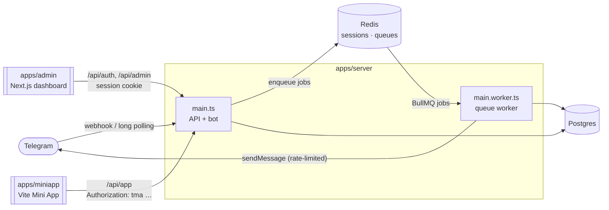
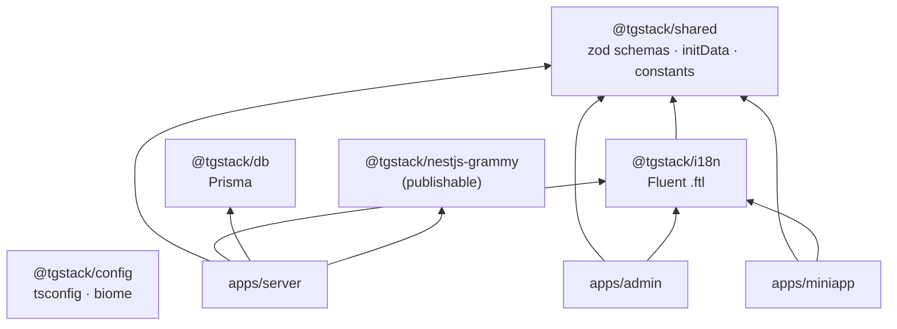

# Architecture

tgstack is a **modular monolith with an event-driven worker**, in a pnpm + Turborepo monorepo. One NestJS codebase runs as two processes; two frontends talk to it over HTTP; four internal packages hold what they share.



In production Caddy sits in front of everything on one domain: `/api`, `/telegram` and `/health` go to the server, `/app/` to the Mini App, the rest to the dashboard (`docker/Caddyfile`, [deployment](deployment.md)).

## Packages and the dependency graph



| Package | May import | Never imports |
|---|---|---|
| `packages/config` | nothing | — |
| `packages/shared` | `zod` | Node-only APIs (it runs in browsers: Web Crypto for initData) |
| `packages/i18n` | `@fluent/bundle`, `@tgstack/shared` (locale list) | — |
| `packages/db` | Prisma, `pg` | NestJS (`PrismaService` lives in the server) |
| `packages/nestjs-grammy` | `@nestjs/*`, `grammy`, `@grammyjs/runner` | any `@tgstack/*` package or app — it is published on its own |
| `apps/server` | every package | — |
| `apps/admin`, `apps/miniapp` | `@tgstack/shared`, `@tgstack/i18n` | `@tgstack/db`, server code |

Values the apps must agree on — supported locales, the session cookie name, the `tma` auth scheme, route prefixes — live in `@tgstack/shared` (`src/constants`), never as string literals in an app.

## Two processes, one codebase

| | `main.ts` | `main.worker.ts` |
|---|---|---|
| Root module | `AppModule` | `WorkerModule` |
| Boots with | `NestFactory.create` (HTTP) | `NestFactory.createApplicationContext` (no HTTP) |
| Does | REST + SSE, bot webhook or polling runner, **enqueues** jobs | BullMQ **processors**: broadcasts |
| Telegram client | grammY `Bot` with middleware, auto-retry | bare `Api` client, handles `429` itself |
| Scale | horizontally behind the proxy (webhook mode) | add workers; the rate limit is global (in Redis) |

Both import the same infrastructure (`ConfigModule`, `LoggingModule`, `PrismaModule`, `RedisModule`, `QueueModule`). The API process never registers a processor; the worker never listens on a port. In Docker they are the same image with a different command.

## Server layout

```text
apps/server/src/
├─ main.ts · main.worker.ts        entry points
├─ app.module.ts · worker.module.ts root modules
├─ bootstrap.ts                    HTTP setup shared with the e2e tests
├─ config/                         zod-validated env → AppConfig
├─ common/                         cross-cutting, no business logic
│  ├─ decorators/                  @AdminController @MiniAppController @CurrentAdmin @AppUser
│  ├─ guards/                      AdminGuard (cookie) · MiniAppAuthGuard (initData) · BotAdminGuard
│  ├─ filters/                     AllExceptionsFilter (HTTP + bot)
│  ├─ interceptors/                BigIntSerializerInterceptor
│  └─ pipes/                       zod (Standard Schema) validation pipe
├─ infra/                          stateful connections
│  ├─ prisma/ · redis/ · queue/    PrismaService · ioredis · BullMQ QueueFactory
│  ├─ logging/                     nestjs-pino
│  └─ health/                      GET /health (Postgres + Redis)
├─ bot/                            the Telegram bot
│  ├─ bot.module.ts                GrammyModule config: mode, transformers, allowed updates
│  ├─ middlewares/                 the pipeline, one file per step
│  └─ updates/                     core commands: /start /help /language
├─ modules/                        core domain, one folder per feature
│  ├─ auth/                        magic link (/admin), /api/auth/*
│  ├─ users/                       upsert, /api/admin/users/*, /api/app/me
│  ├─ stats/                       /api/admin/stats
│  ├─ broadcasts/                  controller (REST + SSE), service (state machine), processor (worker)
│  └─ payments/                    interfaces/ · providers/ (Telegram Stars) · payments.update.ts · controller
├─ examples/                       // EXAMPLE: deletable — shop, onboarding wizard
└─ dev/mock-bot.ts                 `pnpm dev:mock`: the stack without a real bot token
```

A feature folder holds everything about that feature: its module, controllers for every audience, services, bot handlers (`*.update.ts`), mappers (`*.mapper.ts`) and, for broadcasts, its queue processor. Dependencies point one way:

```
examples → modules → bot / common → infra → config
```

The only edges against the flow are the identity services every request needs: the bot's user-upsert middleware uses `UsersService`, and the guards in `common/` use `AuthService` and `UsersService`. Nothing outside `examples/` imports from it except `app.module.ts`, which registers the example modules.

The other apps follow the same idea:

```text
apps/admin/src/app/(auth)/        /login, /auth/callback — public, centered layout
apps/admin/src/app/(dashboard)/   /, /users, /broadcasts, /products (EXAMPLE), /payments
apps/admin/src/proxy.ts           redirect to /login without a session cookie (Next 16 "proxy")
apps/miniapp/src/app/             App, context, Telegram SDK init + theme sync
apps/miniapp/src/pages/           profile/ · shop/ (EXAMPLE)
apps/miniapp/src/lib/api.ts       API client, sends `Authorization: tma <initData>`
apps/miniapp/src/mocks/           Telegram environment for browser development (never shipped)
```

## Rules

These are checked by `apps/server/test/architecture.spec.ts` where a test can check them.

### 1. Bot middleware order

Every update runs through, in this order (`bot/middlewares/`):

| # | Step | Why here |
|---|---|---|
| 0 | Error boundary (`error-boundary.ts`, installed by nestjs-grammy) | catches everything below; logs with the update id and replies "something went wrong" in the user's language |
| 1 | `sequentialize` | the runner processes updates concurrently; one chat's updates must not interleave |
| 2 | Logging | type, user, chat, outcome, latency |
| 3 | User upsert → `ctx.user` | `lastSeenAt`, profile, `isBlocked` (set on `my_chat_member: kicked`, cleared by any other update) |
| 4 | Session (Redis) → `ctx.session` | needs the chat id only |
| 5 | i18n → `ctx.t` | negotiates `user.locale` → `language_code` → `en`, so it needs `ctx.user` |
| 6 | `beforeConversations` | payment updates must not be swallowed by an open wizard |
| 7 | Conversations (Redis) | wizards survive restarts |
| 8 | `/cancel` | must run before a conversation resumes |

Then the `@Update()` handlers.

### 2. HTTP namespaces and authentication

| Prefix | Guard | Credential |
|---|---|---|
| `/api/auth/*` | none / `AdminGuard` for `me`, `logout` | one-time token from the bot → httpOnly session cookie |
| `/api/admin/*` | `AdminGuard` via `@AdminController()` | session cookie, user must still be `ADMIN` |
| `/api/app/*` | `MiniAppAuthGuard` via `@MiniAppController()` | `Authorization: tma <initData>`, HMAC-checked with the bot token, max age |
| `/telegram/webhook` | grammY `webhookCallback` | `X-Telegram-Bot-Api-Secret-Token` header (`401` otherwise) |
| `/health` | none | — |

Every controller outside `auth` and `health` must use one of the two namespace decorators; a test fails otherwise.

### 3. Long work goes through the queue

Never loop over users inside a request. `BroadcastsService.start()` moves a broadcast to `QUEUED` and adds one control job; the worker snapshots recipients into per-user `send` jobs in batches of 500. Sending is paced by a BullMQ limiter (`BROADCAST_RATE_PER_SECOND`, default 25/s, never bursting). `429` pauses the whole queue for `retry_after`; `403` marks the user blocked and counts the message as failed without retrying; other `4xx` fail; network errors and `5xx` get up to three attempts. Details: [broadcasts](broadcasts.md).

### 4. Payments: fast pre-checkout, idempotent success

`pre_checkout_query` must be answered within 10 seconds: verify the signed payload, the payer, that the product is active and the price unchanged, nothing else. `successful_payment` inserts with `skipDuplicates` on the unique `telegramPaymentChargeId`, so a re-delivered update records nothing twice. Gateways plug in through `PaymentProvider` (`modules/payments/interfaces`). Details: [payments](payments.md).

### 5. BigInt stops at the server boundary

Telegram IDs are `BigInt` in Postgres and strings in every JSON payload (`telegramIdSchema` in `@tgstack/shared`). Mappers convert explicitly (`users.mapper.ts`, `payments.mapper.ts`); the global `BigIntSerializerInterceptor` is the safety net for REST and SSE.

### 6. Examples are removable

Showcase features live in `apps/server/src/examples/`, `apps/miniapp/src/pages/shop/` and `apps/admin/src/app/(dashboard)/products/`, and every file is marked `// EXAMPLE:`. Deleting them never breaks auth, users, broadcasts or payments ([examples](examples.md)).

## Where this differs from the original architecture guide

The layout follows the restructuring guide, with six deliberate differences recorded in [decision D37](decisions.md#d37--where-the-implementation-departs-from-the-architecture-guide-2026-10-22): feature-owned bot handlers (`/admin` in `auth`, payment handlers in `payments`), two extra pipeline steps, our own Redis session storage, queue names kept in the server, per-app translation files, and Next 16's `proxy.ts`.
